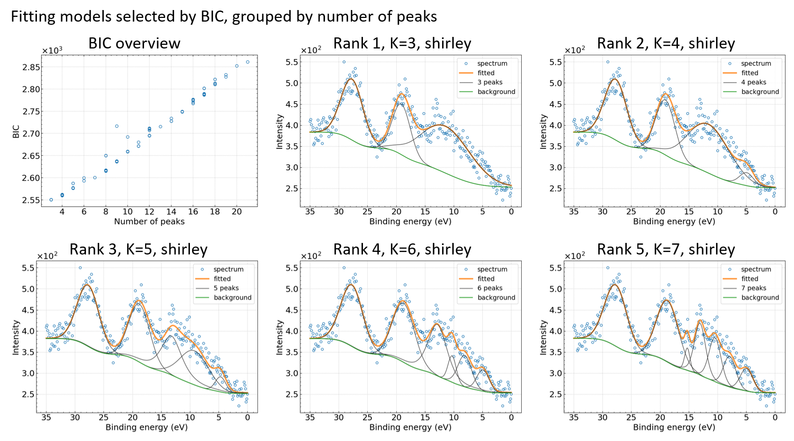

# xps-bic-fitting-pv
BIC based fitting of XPS spectra using pseudo‑Voigt basis functions.

## 概要
これはXPSのナロースペクトルのピーク分離ツールです。
与えられたナロースペクトルについて、さまざまなピーク本数から成る最大155通りの初期値を元に擬似Voigt関数を基底関数としてピークフィッティングを実行し，その結果をベイズ情報量規準(Bayesian information criterion, BIC)で評価して上位の解のパターンを出力します．

以下に示す6枚の図のうち，左上の図はフィッティングの解を構成するピーク本数 K に対するBICの値です．BICはフィッティングの良さとモデルの複雑さをバランスよく評価する指標で，BICの小さい解はピーク数が少なくかつフィッティングが良好なものとなります．その他の図は解の候補で，BICの小さい順にランクの値を付け，ピーク本数 K の値とともに示されます．図中の shirley は Shirley のバックグラウンドを用いることを示します．



## 開発環境
- Ubuntu 22.04 LTS
- gcc 11.4.0
- Python 3.12.10
  - numpy, matplotlib, pandas, python-pptx
- LAPACK, BLAS, OpenMP

## 環境構築と実行手順
### 環境構築
```bash
sudo apt update && sudo apt install -y liblapack-dev libgomp1
make -C src -j
uv venv
source .venv/bin/activate
uv sync
```

### 実行手順
```bash
cd sample
bash ../src/exec_single.sh PVMK_VB.csv
```

## 入力データ
- XPSスペクトルデータ

### XPSスペクトルデータの書式
XPSスペクトルデータはヘッダなし2列のCSV形式であること．
第1列はeV単位の結合エネルギーで降順に並んでいること．
第2列はスペクトルの強度で0以上の正の実数値であること．

例(`PVMK_VB.csv`)：
```
35.0,409.0
34.875,414.0
34.75,401.0
34.625,386.0
34.5,394.0
・・・
```


## 計算結果
プログラムを実行した結果，スペクトルデータ`PVMK_VB.csv`のファイル名に基づいて`PVMK_VB`フォルダが作られ，その中に解析結果が格納される．
本ツールはさまざまなピーク本数から成る最大155通りのピークフィッティングを実行する．その後以下の条件でフィルタリングを行い，抽出されたフィッティングモデルをファイル出力する．<br>
- XPSの分解能を考慮して，すべてのピークの半値半幅が0.1eVより大きいモデルのみ抽出する．<br>
- 一つのピーク本数について複数のフィッティングモデルがある場合は，その中で最もBIC値の小さいモデルを一つ選ぶ．<br>
- それらのフィッティング結果をBIC値の小さい順にランク付けする．<br>
- BIC値の上位5件のピーク本数を調べ，それらよりもピーク本数が多いモデルは複雑さの度合いが大きすぎるため除外する．<br>

デフォルトではShirleyバックグラウンドを仮定した結果が採用される．Shirleyバックグラウンドのモデルが見つからなかった場合には直線バックグラウンドの結果が採用される．<br>

### 計算結果の一覧
出力フォルダ`PVMK_VB`の内容は次の通り
```
PVMK_VB
├── BIC_vs_NumPeak.png
├── PVMK_VB.csv
├── gbp_rank1_numPeak3_shirley_mSG2880_parameters.csv
├── gbp_rank1_numPeak3_shirley_mSG2880_result.csv
├── gbp_rank1_numPeak3_shirley_mSG2880_result.png
├── gbp_rank2_numPeak4_shirley_mSG1536_parameters.csv
├── gbp_rank2_numPeak4_shirley_mSG1536_result.csv
├── gbp_rank2_numPeak4_shirley_mSG1536_result.png
├── gbp_rank3_numPeak5_shirley_mSG1216_parameters.csv
├── gbp_rank3_numPeak5_shirley_mSG1216_result.csv
├── gbp_rank3_numPeak5_shirley_mSG1216_result.png
├── gbp_rank4_numPeak6_shirley_mSG1024_parameters.csv
├── gbp_rank4_numPeak6_shirley_mSG1024_result.csv
├── gbp_rank4_numPeak6_shirley_mSG1024_result.png
├── gbp_rank5_numPeak7_shirley_mSG0992_parameters.csv
├── gbp_rank5_numPeak7_shirley_mSG0992_result.csv
├── gbp_rank5_numPeak7_shirley_mSG0992_result.png
├── input_spectrum2.png
├── log2.txt
├── log3.txt
├── log_as_shirley.txt
├── recipe.txt
├── result_figures.pptx
├── stderr
├── stdout
└── summary_BIC.csv
```

- パワーポイントファイル
  - `result_figures.pptx`: まとめスライド．BIC vs. ピーク本数の図およびフィッティング結果の図の一覧
- 画像ファイル
  - `BIC_vs_NumPeak.png`: BIC vs. ピーク本数の図
  - `gbp_rank(*1)_numpeak(*2)_(*3)_mSG(*4)_result.png`: フィッティング結果の図．
    (*1)～(*4)の意味は次の通り．
    - (*1) BIC値に基づくランク
    - (*2) ピーク本数
    - (*3) バックグラウンドモデルの種類．shirleyまたはlinear
    - (*4) ピークフィッティングの初期モデルごとに与えられるID
  - `input_spectrum2.png`: 入力スペクトルの図
- 数値データファイル
  - `summary_BIC.csv`: ピーク本数とBICの数値データ
  - `gbp_rank(*1)_numpeak(*2)_(*3)_mSG(*4)_parameters.csv`: フィッティングパラメータの数値データ
  - `gbp_rank(*1)_numpeak(*2)_(*3)_mSG(*4)_result.csv`: フィッティング結果を描画するための数値データ
- ログファイル
  - `stdout`: `automatic_xps_peak_separation_single.py` の標準出力．
      ここにはツールのバージョン名が記録される．    例：`# toolname               = xps-ps-pv-20230919`
  - `stderr`: `automatic_xps_peak_separation_single.py` の標準エラー．
  - `log_as_shirley.txt`: Shirleyバックグラウンドを仮定してピークフィッティングを実行したときの標準出力
  - `log_as_linear.txt`: 直線バックグラウンドを仮定してピークフィッティングを実行したときの標準出力
  - `log2.txt`: BICに基づくランク付けおよび画像ファイルを作成したときの標準出力
  - `log3.txt`: `result_figures.pptx`を作成したときの標準出力


## 出力データの書式

- `summary_BIC.csv`: ピーク本数とBICの数値データ．例：
  ```
  method,smoothing_point,numPeak,bic_gauss
  shirley,6,21,2861.299125658493
  shirley,8,14,2734.0061184433384
  shirley,10,17,2801.732285024325
  ・・・
  ```

各列の意味は次の通り．

  | Label           | Description                                        |
  | --------------- | -------------------------------------------------- |
  | method          | バックグラウンドモデルの種類．shirleyまたはlinear  |
  | smoothing_point | ピークフィッティングの初期モデルごとに与えられるID |
  | numPeak         | ピーク本数                                         |
  | bic_gauss       | BIC値                                              |


- `gbp_rank*_numpeak*_*_mSG*_parameters.csv`: フィッティングパラメータの数値データ．例：
  ```
  peakID,height,position,width,lorentzRatio,area
  0,1.44245e+02,27.682,2.253,0.000,6.91920e+02
  1,1.20001e+02,19.103,1.858,0.000,4.74715e+02
  2,1.11052e+02,11.441,5.178,0.000,1.22414e+03
  ```

各列の意味は次の通り．

  | Label        | Description                            |
  | ------------ | -------------------------------------- |
  | peakID       | ピークのID．開始は0．                  |
  | height       | ピークの高さ (arb. units)              |
  | position     | ピーク位置 (eV)                        |
  | width        | ピークの半値半幅 (eV)                  |
  | lorentzRatio | 擬似Voigt関数のローレンツ-ガウス混合比 |
  | area         | ピーク面積                             |

- `gbp_rank*_numpeak*_*_mSG*_result.csv`: フィッティング結果を描画するための数値データ．例：
  ```
  Binding_Energy(eV),spectrum,smoothing,background,sum_peaks,fitting,peak[0],peak[1],peak[2]
  35,409,381.614,383.396,0.0963825,383.493,383.493,383.396,383.396
  34.875,414,381.669,383.396,0.12346,383.519,383.519,383.396,383.396
  34.75,401,381.763,383.395,0.157472,383.552,383.552,383.395,383.395
  34.625,386,381.906,383.394,0.2,383.594,383.593,383.394,383.394
  34.5,394,382.109,383.392,0.252934,383.645,383.645,383.392,383.392
  ・・・
  ```

各列の意味は次の通り．

  | Label              | Description                                              |
  | ------------------ | -------------------------------------------------------- |
  | Binding_Energy(eV) | 結合エネルギー (eV)                                      |
  | spectrum           | 入力スペクトルデータ (arb. units)                        |
  | smoothing          | 入力スペクトルにスムージングを掛けたデータ               |
  | background         | 最適化モデルのバックグラウンド(BG)                       |
  | sum_peaks          | 最適化モデルの全ピークを足し合わせたデータ．BGは含まない |
  | fitting            | 最適化モデルの全ピーク＋BGのスペクトルデータ             |
  | peak[#]            | #番目のピークIDに対応するピーク+BGのスペクトルデータ     |


## プログラムパッケージ
```
src
├── *.cpp
├── *.h
├── exec_single.sh
├── automatic_xps_peak_separation_single.py
├── make_result_figures_ppt2.py
├── makefile
├── myfunc.py
├── plot_result_shirley_and_linear.py
├── recipe.txt
└── settings.inp

```

- exec_single.sh: メインの実行スクリプト
- automatic_xps_peak_separation_single.py: 処理の流れを制御
- `*.cpp`, `*.h`: 計算エンジンのソースコード
- plot_result_shirley_and_linear.py: 結果をBICに基づいてランク付けし，図を作成する．
- myfunc.py: 関数群
- make_result_figures_ppt2.py: まとめスライドを作成
- settings.inp: 設定ファイル
- recipe.txt: まとめスライドに表示するピーク本数の最大数を指定


### 設定ファイルについて
設定ファイル `settings.inp` によりプログラムの動作を調整することができ，ピークの半値全幅の最小値とx軸ラベルを変えることができる．
- ピークの半値全幅の最小値を調整するときは次のように記述する：
  `minimumPeakFWHM     0.2` 
  数値の単位は入力データのx軸の数値の単位と揃えること．スペクトルの種類によって適切なピークの幅の最小値を与えること．
- フィッティングの図のx軸ラベルを調整するときは次のように記述する：
  `plot_xlabel     Binding_energy_(eV)`

#### XPSスペクトルの解析の場合
空の設定ファイル `settings.inp` をそのまま使用する．
この場合，ピークの半値全幅の最小値は `0.2` eV，x軸ラベルは `Binding_energy_(eV)` となる．

#### X線スペクトルの解析の場合
例としてピークの半値全幅の最小値を `2.2` eV に，x軸ラベルを `Energy_(eV)` に変更する場合は次のように記述する．
- settings.inp
  ```
  minimumPeakFWHM              2.2
  plot_xlabel                  Energy_(eV)
  ```


## 実行時オプション
以下の設定が可能である．デフォルトの設定のまま実施することを強く推奨する．

<!-- 
- 並列処理の最大数
  - 環境変数`OMP_NUM_THREADS`の数値によりスレッド数を変えることができる．
  - デフォルトでは`exec_single.sh`にて`export OMP_NUM_THREADS=16` と設定しており，16スレッドで処理が行われる．
  - `OMP_NUM_THREADS`の指定がない場合はシングルスレッドで実行される．
-->
- まとめスライドの出力
  - `automatic_xps_peak_separation_single.py` に引数 `-p` を与えた場合（デフォルトで有効），まとめスライドを作成する．
  - `automatic_xps_peak_separation_single.py` に引数 `-p` がない場合，まとめスライドを作成しない．
- バックグラウンドモデルの切り換え
  - `automatic_xps_peak_separation_single.py` に引数 `-s`, `-l` のいずれも指定がない場合（デフォルトで有効），始めにShirleyバックグラウンドを仮定して最大155通りのピークフィッティングを実行する．Shirleyバックグラウンドのモデルが一つも見つからなかった場合には，引き続いて直線バックグラウンドを仮定して最大155通りのピークフィッティングを実行する．
  - `automatic_xps_peak_separation_single.py` に引数 `-l` を与えると，Shirleyバックグラウンドを仮定して最大155通りのピークフィッティングを実行する．
  - `automatic_xps_peak_separation_single.py` に引数 `-s` を与えると，直線バックグラウンドを仮定して最大155通りのピークフィッティングを実行する．
- 開発者モード
  - `automatic_xps_peak_separation_single.py` に引数 `-d` を与えると，中間ファイルをすべて残し，最大155通りのすべてのフィッティング結果やその図を取得できる．このオプションを有効にするとファイルサイズが膨大になることに注意．
  - デフォルトではこのオプションは無効．
- まとめスライドに表示するピーク本数の最大数
  - `recipe.txt` を使い，まとめスライドに表示するピーク本数の最大数を指定できる．
    ```
    numPeakMax,100
    ```
    ピーク本数が極端に大きなモデルを表示したくない場合に利用する．

## 計算手法
計算手法の詳細は参考文献[1]を参照のこと．

### 生成モデル
XPSのナロースペクトル $f(x)$ を結合エネルギー $x$ の関数として次式で表現する．

```math
\begin{align}
f(x) &= s(x) + b(x),  \\
s(x) &= \sum_{k=1}^{K} V(x; \mu_k, h_k, w_k, r_k). 
\end{align}
```

$s(x)$ はシグナル関数， $b(x)$ はバックグラウンド関数である． $s(x)$ は $K$ 個のVoigt関数の線形結合で表現され，1つのVoigt関数 $V(x; \mu, h, w, r)$ は次式で定義される．

```math
\begin{align}
V(x; \mu, h, w, r) &= h \left\{ r L(x; \mu, w) + (1 - r) G(x; \mu, w) \right\},  \\
L(x; \mu, w) &= \frac{1}{1 + \left( \frac{x - \mu}{w} \right)^2} , \\
G(x; \mu, w) &= 2^{-\left( \frac{x - \mu}{w} \right)^2}. 
\end{align}
```

$h$ はピークの高さ， $\mu$ はピーク位置， $w$ はピークの半値半幅， $r$ はローレンツ-ガウス混合比である．Shirleyのバックグラウンドの場合，

```math
\begin{align}
b(x) = (I_H - I_L) \frac{\int_{x_L}^{x} s(x') dx'}{\int_{x_L}^{x_H} s(x') dx'} + I_L.  \\
\end{align}
```

ここで $x_L, x_H$ はそれぞれ低結合エネルギー側，高結合エネルギー側の端点の値， $I_L, I_H$ はそれぞれ低結合エネルギー側，高結合エネルギー側のバックグラウンド端点強度である．
直線バックグラウンドの場合は次の通り．

```math
\begin{align}
b(x) =  \frac{I_H - I_L}{x_H - x_L} (x - x_L) + I_L. 
\end{align}
```

### ベイズ情報量規準
数理統計学で用いられるベイズ情報量規準(BIC)を用いてモデル選択を行う．BICは次式で計算される[1]．
```math
\begin{align}
\text{BIC} = -2 \log \hat{L} + m \log N. 
\end{align}
```

$\hat{L}$ は観測されるスペクトルデータ $\{y_i\}_{i=1}^{N}$ とモデル関数 $\{f_i\}_{i=1}^{N}$ のあいだの最大対数尤度， $N$ はスペクトルのデータ数， $m$ はモデル関数に含まれるパラメータ数である．ピーク本数を $K$ として $m = 4 K + 2$ である．観測データに掛かるノイズが一様なガウスノイズであると仮定すると， $\hat{L}$ は次式で計算される．

```math
\begin{align}
-2 \log \hat{L} &= N \left\{ \log(2\pi \hat{\sigma}^2 + 1) \right\},  \\
\hat{\sigma}^2 &= \frac{1}{N} \sum_{i=1}^N \left(y_i - f_i \right)^2. 
\end{align}
```
ピーク本数が増えるほど誤差が小さくなり，BICの第1項は小さくなる．一方でピーク本数が増えるとBICの第2項すなわち罰則項は大きくなる．BIC値の小さいモデルは，ピーク数が少なくかつフィッティングが良好なものとなる．

## 諸注意
- 本ツールはXPSのナロースペクトルを解析するためのプログラムであり，ワイドスペクトルの解析には利用できない．
- 本ツールはベイズ情報量規準に基づいて数理的にモデル選択を行う．スピン軌道分裂のような物理的な要請は考慮しない．
- 設定ファイル settings.inp を別途用意する場合，設定ファイルの最終行は必ず改行しておくこと．
- 本資料に記載がある仕様や留意事項に反する利用の仕方をしたことでエラーが発生した場合は，そのエラーの発生原因の究明およびエラー解消への対応は，MDPFでは行いませんのでご注意下さい。


## 参考文献
[1] H. Shinotsuka, H. Yoshikawa, R. Murakami, K. Nakamura, H. Tanaka, K. Yoshihara, Automated information compression of XPS spectrum using information criteria, Journal of Electron Spectroscopy and Related Phenomena. 239 (2020) 146903. https://doi.org/10.1016/j.elspec.2019.146903.


----
最終更新日 2024/07/01
